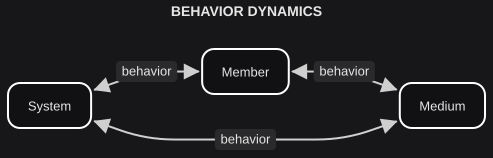

# Behavior Dynamics

*On the rules of the game.*

Identifying the fundamental building blocks of systems analysis is a challenge. We often impose hierarchical structures, but these can <plain>conflict</plain> with the complexity of systemic interactions. Starting with a model that is too simplistic, or overly complex, creates problems of its own as the analysis develops.

We are going to offer a model labeled **Behavior Dynamics**. It contains one main systemic phenomenon (**<plain>Behavior</plain>**) and three main systemic entities (**<plain>System</plain>**, **<plain>Member</plain>**, **<plain>Medium</plain>**).

- **BEHAVIOR**: The <plain>transformation</plain> of a <plain>medium</plain> by <plain>system</plain> members.

- **SYSTEM**: An environment where interrelated members express <plain>behavior</plain>.

- **MEMBER**: A unit that expresses <plain>behavior</plain> within a <plain>system</plain>.

- **MEDIUM**: Components of a <plain>system</plain> transformed by its members to express their <plain>behavior</plain>.

These four are simultaneous and interrelated. You do not first have a <plain>system</plain> and then add members to it, or first have a <plain>medium</plain> and then wait for <plain>behavior</plain> to appear. The <plain>arrangement</plain> is an intellectual device for exploring their <plain>interaction</plain>, not a claim about which one is more real.

The distinction that most often collapses is the one between **<plain>system</plain>** and **<plain>medium</plain>**. A garden, as an environment of interrelated members — plants, insects, a gardener — is a <plain>system</plain>. The soil the gardener works, the water they redirect, the seeds they select: those are <plain>medium</plain>. <plain>Behavior</plain> is what happens when members transform that <plain>medium</plain>. If you treat the soil as if it were the garden, or the garden as if it were a pile of soil, the rest of this framework will not sit still.

Other starting systemic models can be compatible with <plain>Conciliatorics</plain>, as long as they do not hinder its intentions. We welcome analytical bridges with other models. And if a better starting model is found later — endogenous or by external suggestion — we will adapt it to the rest of the work. We needed a starting framework. This is the one we are using.
