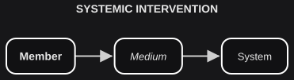
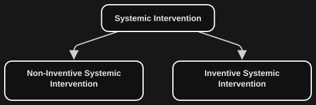
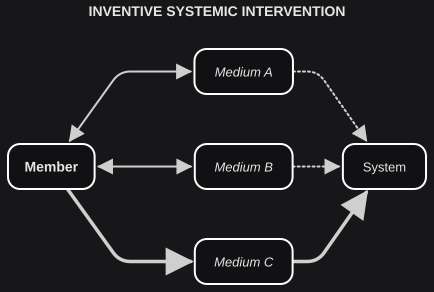

# Systemic Intervention

*On entering the field.*

Behavior Dynamics leads to various types of interactions and configurations. One of them is **<plain>Systemic Intervention</plain>**. This <plain>interaction</plain> is explicitly hierarchical and based on the <plain>member</plain> entity.

- **SYSTEMIC INTERVENTION**: Action performed by a <plain>member</plain> that seeks to influence the <plain>behavior</plain> of a <plain>system</plain>.

- **INTERVENER**: <plain>Member</plain> that implements <plain>systemic intervention</plain> in a <plain>system</plain>.

A <plain>member</plain>'s <plain>behavior</plain> can be intentional or not, localized or expansive, short-term or planned ahead. <plain>Systemic intervention</plain> is intentional, expansive, and planned ahead. That <plain>behavior</plain> designates a <plain>member</plain> as an **<plain>intervener</plain>**. The label does not preclude the same <plain>member</plain> from holding other roles in the same <plain>system</plain>. Further developments in <plain>Behavior Dynamics</plain> will introduce additional <plain>interaction</plain> labels.

## Inventive Intervention

Of the different subtypes of <plain>systemic intervention</plain>, we will narrow our focus to one that will serve as the main foundation of <plain>Conciliatorics</plain>: **<plain>Inventive Systemic Intervention</plain>**. For simplicity, we will refer to this subtype as **Inventive Intervention**. For now, any other subtypes will be categorized as **<plain>Non-Inventive Systemic Intervention</plain>**, so that we do not diverge from our focus.

- **INVENTIVE SYSTEMIC INTERVENTION**: Exploration of a <plain>system</plain>'s <plain>medium</plain> that seeks to influence its <plain>behavior</plain>.

Inventive intervention works the <plain>medium</plain> *before* proceeding to the <plain>system</plain>'s effects. A cook does not influence a meal by instructing the guests; they work the ingredients. A legislator does not influence a polity by wishing it otherwise; they work the text of a statute, the <plain>medium</plain> through which that influence is supposed to travel. In both cases the intended intervention is enhanced by staying with the <plain>medium</plain> long enough to change it.

While the <plain>medium</plain> is transformed toward its desired state, the intervener can also improve their craftsmanship. That feedback runs among all three entities: a better <plain>medium</plain>, a more capable <plain>member</plain>, a <plain>system</plain> whose <plain>behavior</plain> has somewhere to go. When several interveners enter the same loop, and when that loop stretches across space and time, the <plain>behavior</plain> that results is highly complex.

To manage inventive intervention at this analytical level, we need a concise yet flexible foundation. We will break that complexity into distinct parcels.
