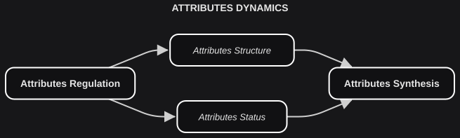

# Attributes Dynamics

*On mapping the unseen.*

Part 1 left us at the parcel with the highest risk of ossification: Edified Interstitial Contemplation, or **EIC**. Its associated field is Philosophy. Its job, inside Conciliatorics, is contemplative work on interstitial qualities of Behavior Dynamics — not a new cosmology, and not a license to start from scratch.

The material of that work is the **<plain>Attribute</plain>**.

- **ATTRIBUTE**: Specific quality of a system, member or a medium. In this framework, an <plain>attribute</plain> is not merely a passive trait but a dynamic component that interacts with behavior, structure, and purpose.

Many philosophical frameworks invent a new foundation for every such quality. We already have <plain>Behavior Dynamics</plain>. That starting model keeps EIC congruent with the other inventive parcels, so that an analytical development here can still be traced back to the same members, <plain>medium</plain>, and <plain>system</plain> that the sciences, technology, and the arts also engage.

What we still need is a structure that lets us explore those qualities without the exploration falling apart. We'll label this model **<plain>Attributes Dynamics</plain>**. It is not to be carelessly altered — any revision must account for its impact on the rest of the conceptual ecosystem.

- **ATTRIBUTES DYNAMICS**: An EIC model designed to promote analytical exploration and integration of attributes.
- **ATTRIBUTES REGULATION**: EIC step that provides the rule set for the <plain>attributes structure</plain> and status exploration.
- **ATTRIBUTES STRUCTURE**: EIC step that explores the <plain>interstitial anatomy</plain> components of <plain>Behavior Dynamics</plain>.
- **ATTRIBUTES STATUS**: EIC step that studies the <plain>interstitial physiology</plain> processes of <plain>Behavior Dynamics</plain>.
- **ATTRIBUTES SYNTHESIS**: EIC step that integrates the exploration of <plain>attributes structure</plain> and status.

<plain>Attributes Structure</plain> and <plain>Attributes Status</plain> have the largest <plain>potential</plain> for conceptual exploration and implementation. <plain>Attributes Regulation</plain> and <plain>Attributes Synthesis</plain> serve as containers: they keep that exploration congruent within EIC and with the rest of the <plain>inventive parcels</plain>.

We begin with <plain>Attributes Regulation</plain>.
