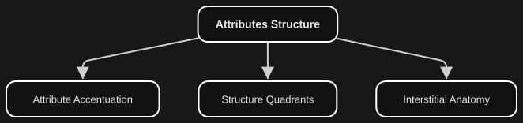

# Attribute Accentuation

*On heed and periphery.*

Attributes Structure is the stretch of EIC that builds toward <plain>Interstitial Anatomy</plain>. We get there by applying operators to the pairs of the primary jurisdiction. The first of those operators, used *inside* a pair, is **accentuation**.

- **ATTRIBUTES STRUCTURE**: EIC step that explores the <plain>interstitial anatomy</plain> components of <plain>Behavior Dynamics</plain>.

- **ATTRIBUTE ACCENTUATION**: Temporary focus on one member of an attribute pair, without dismissing the other side.

The Stillness–Movement pair begins in symmetry: **<plain>Stillness ≡ Movement</plain>**. A garden at rest and a garden at work are not two gardens. Focusing on the still one does not break that <plain>symmetry</plain>, so long as the working one is not dismissed. <plain>Accentuation</plain> marks the focus: **<plain>Stillness ← Movement</plain>**.

| **ACCENTUATION** | **SYMBOLIC FORM** |
|----|---|
| Stillness ← Movement = Pro-Stillness | Q <plain>←</plain> M = pQ |
| Movement ← Stillness = Pro-Movement | M <plain>←</plain> Q = pM |
| Simultaneity ← Successiveness = Pro-Simultaneity | Si <plain>←</plain> Su = pSi |
| Successiveness ← Simultaneity = Pro-Successiveness | Su <plain>←</plain> Si = pSu |

Using the full pair every time soon becomes impractical. Naming only "<plain>Stillness</plain>" is worse: the complement disappears from the page and, soon after, from the analysis. The "pro-" prefix keeps the pair in view: **<plain>Stillness ← Movement = Pro-Stillness</plain>**.

In EIC, "pro" does not imply <plain>preference</plain>, and it does not mean we are against the other side (there is no "Anti-<plain>Movement</plain>" here). Focusing on the still garden is not a vote against the working one. The other side remains available. The prefix is a concise tool for building further concepts while staying inside <plain>Attributes Regulation</plain>.

The form `Q ← M = pQ` will carry that focus into denser configurations. Next we join these accentuations to one another.
