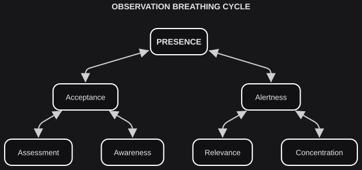

# Observation

*On insights.*

Observation can take the same **bounded** / **non-bounded** cut as discernment, but the job is different. The last chapter was a method of knowing. This one is a method of watching — and of noticing when the watch has already hardened into a verdict.

- <plain>**Bounded Observation**: Judgement</plain>
- <plain>**Non-bounded Observation**: Attention</plain>

When we judge, we attach our own perspectives, priorities, and biases to the act of observing. To empty that <plain>judgement</plain> out, we attend to the world as if we were not the one performing the act. A chair who has already decided what the vote means is judging. One who hears the next speaker as if the outcome were still open is attending. Both are <plain>observation</plain>.

An <plain>observation</plain> can also be **top-down** or **bottom-up**. The two complement each other: top-down tends to be planned and overarching; bottom-up, spontaneous and specific. These do not need extra names. Combined with judgement and attention they give four **<plain>observation forms</plain>**:

| **<plain>OBSERVATION FORMS</plain>** | **Judgement** | **Attention** |
|---|---|---|
| **Top-Down** | Assessment | Awareness |
| **Bottom-Up** | Relevance | Concentration |

<plain>Discernment</plain>, at a similar stage, branched into children. <plain>Observation</plain> does the opposite: it intersects the forms until they condense into one type, **<plain>Presence</plain>**.

**Assessment** places us as judges of the world — right or wrong, suitable or inconvenient. **Awareness** contemplates the landscape without that <plain>judgement</plain>. Integrate them and we get <plain>**acceptance**: holistic attention with judgement</plain> still available when it is needed.

- Assessment ^ Awareness = Acceptance

The world keeps offering more than we can hold. We feel compelled to assign a **relevance** <plain>order</plain> to its manifestations; we can also **concentrate** on one aspect outside our immediate <plain>judgement</plain>. Integrate them and we get <plain>**alertness**: open concentration, with relevance</plain> still available.

- Relevance ^ Concentration = Alertness

A last integration remains. <plain>Acceptance and alertness together are **presence**: the state of fullness observation</plain>.

- Acceptance ^ Alertness = Presence

<plain>Presence</plain> is constantly disrupted by inner and outer stimuli. It is not a final destination. It is a *resting point* — a state we can return to, not a state we are required to occupy without break. When it breaks, <plain>observation</plain> can drift, or we can come back. An **<plain>observation breathing cycle</plain>** is the right picture for that motion:

